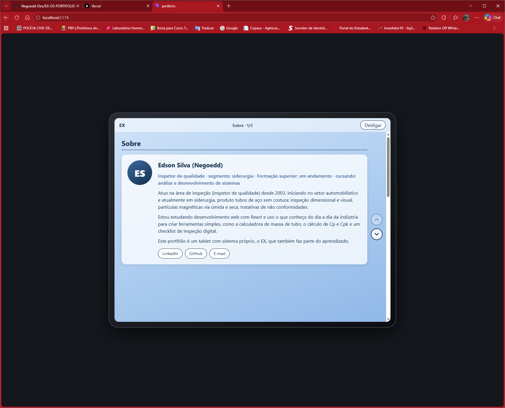

# Portfólio EX

Meu portfólio na forma de um tablet com sistema próprio, o **EX**: tela desligada, boot animado, login e seções em cards.



**Demo:** _(preencha quando publicar)_

## Por que criei

Estou estudando desenvolvimento web e trabalho como inspetor de qualidade no setor de siderurgia. Quis um portfólio que fosse também um projeto, e que mostrasse tanto o que estou aprendendo quanto os conhecimentos da minha área. Os projetos mostrados nele (calculadora de massa de tubo, Cp e Cpk, checklist de inspeção) nasceram de problemas reais do meu dia a dia.

## O que ele faz

- Tela preta, botão EX, boot em azul suave com o logotipo animado letra por letra.
- Login de demonstração e tela principal com as seções **Sobre**, **Skills** e **Projetos**.
- Duas setas para navegar entre as seções, também acessível pelo teclado.
- Layout que se adapta de tablet a celular.

## Tecnologias

React, Vite, JavaScript, CSS.

## Como editar o conteúdo

Os textos e links ficam todos em `src/conteudo.js`. O nome do sistema e o login ficam em `src/config.js`. Não é preciso mexer nos componentes.

## Como rodar

Requisito: [Node.js](https://nodejs.org) 18 ou superior.

```bash
git clone https://github.com/seu-usuario/portfolio-ex
cd portfolio-ex
npm install
npm run dev
```

Abra o endereço que aparecer no terminal (normalmente http://localhost:5173).
Sem o Git, baixe o ZIP pelo botão verde **Code** desta página.

## Observações

- O login é **apenas decorativo** (faz parte da experiência do tablet). Não protege nada e não deve ser usado como segurança real.

## Autor

Negoedd · [LinkedIn](https://www.linkedin.com/in/seu-perfil)
